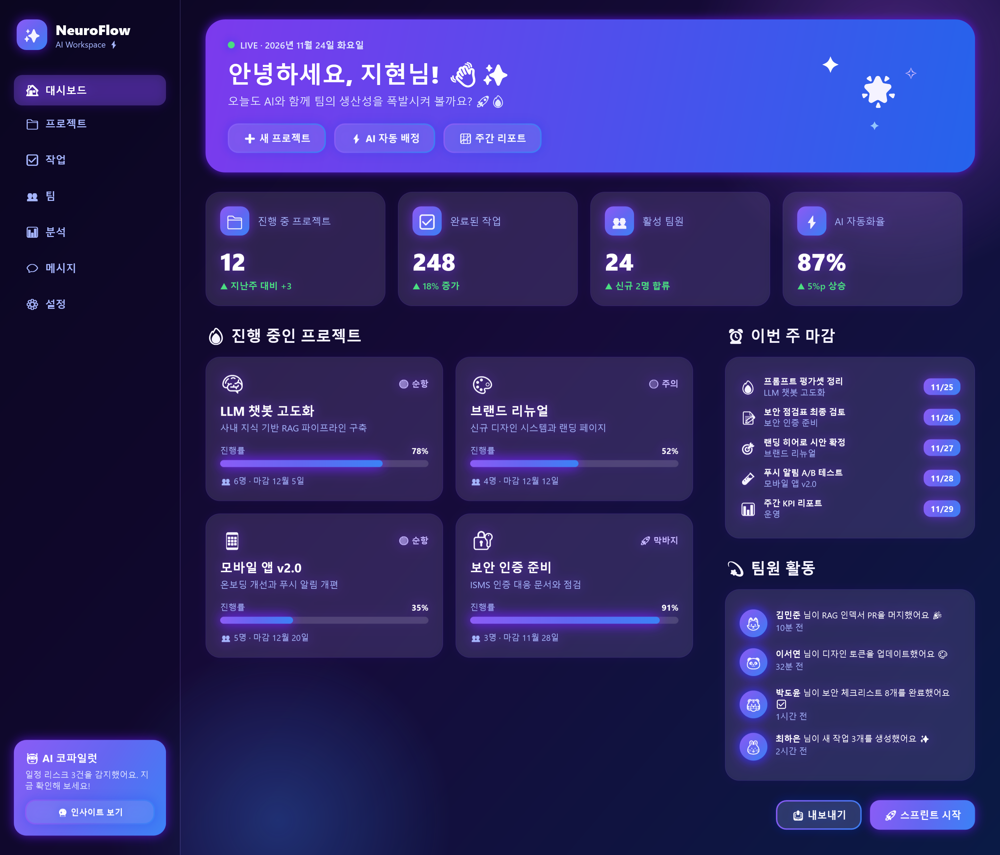
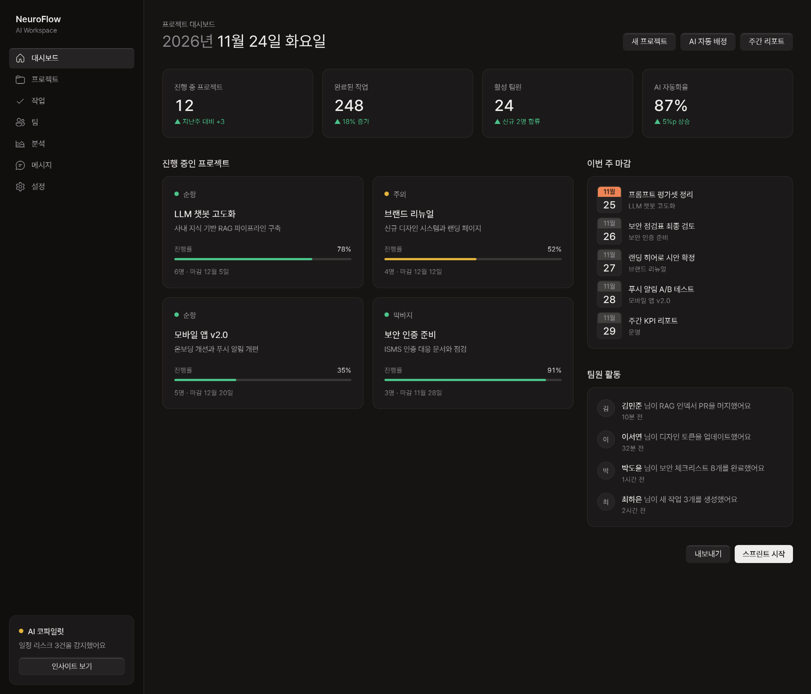
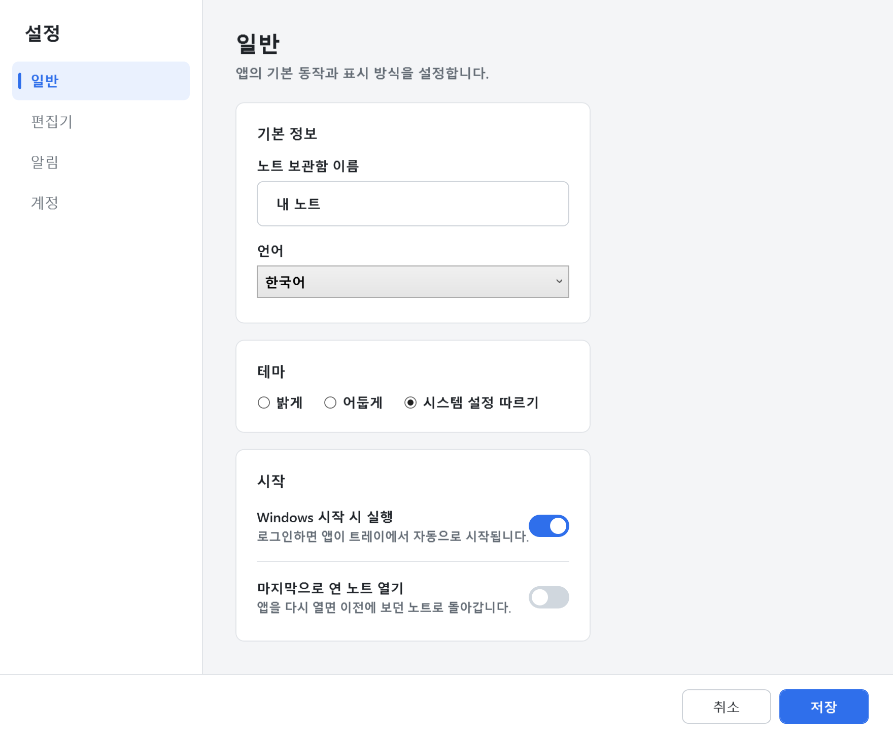
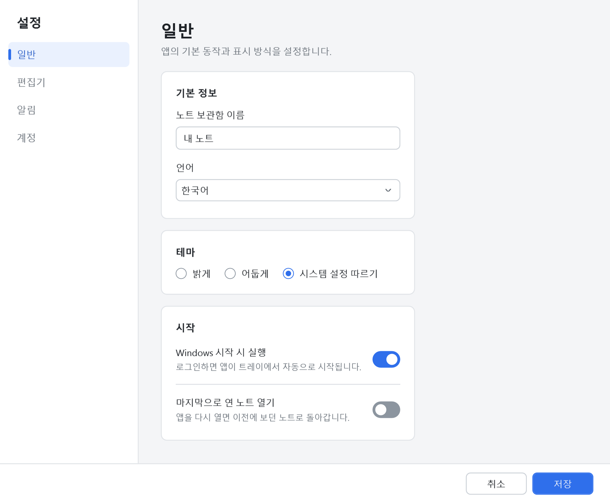
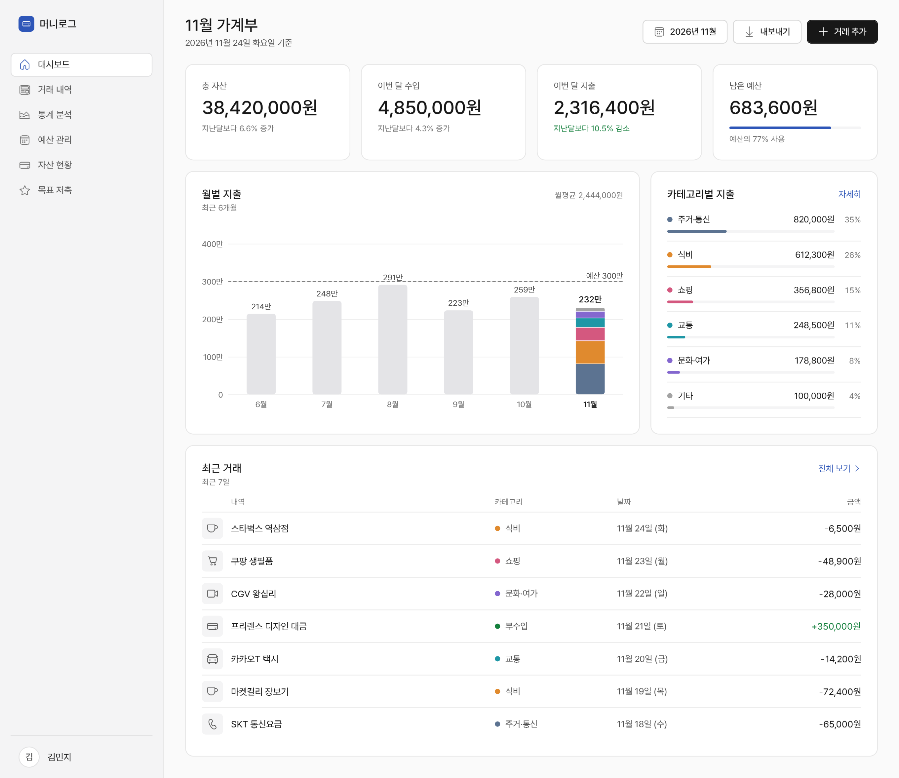
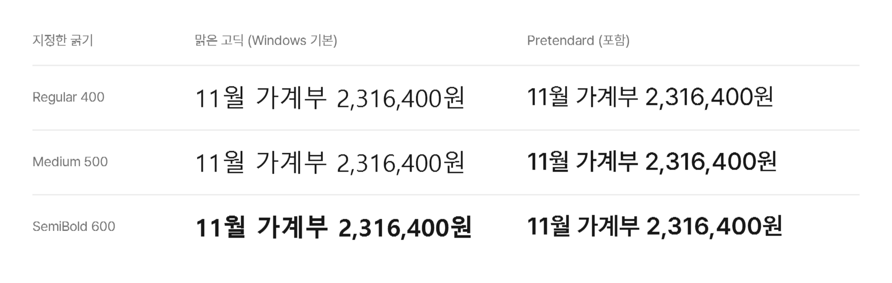

# wpf-unslop

AI가 만든 티가 나는 WPF 화면을 제품의 성격이 드러나는 데스크톱 인터페이스로 다듬는 Claude Code skill입니다. 웹 UI용 skill인 [unslop](https://github.com/heydamir/unslop)의 판단 기준과 절차를 그대로 가져오고, 수정 방식과 확인 방식을 WPF XAML에 맞게 바꿨습니다. 원작자와 관계없는 비공식 변형이며, 원작자가 승인하거나 관리하지 않습니다.

| 항목 | 내용 |
| --- | --- |
| 대상 | WPF `Window`, `UserControl`, `ResourceDictionary` (.NET Framework 4.x, .NET 6 이상) |
| 실행 환경 | Claude Code, Windows, Windows PowerShell 5.1 |
| 원본 | [heydamir/unslop](https://github.com/heydamir/unslop) (CC BY 4.0) |
| 라이선스 | CC BY 4.0 ([LICENSE](LICENSE)), `scripts/`만 MIT ([scripts/LICENSE](skills/wpf-unslop/scripts/LICENSE)). 자세한 내용은 [NOTICE.md](NOTICE.md) |

## 전후 비교

AI 티가 심한 WPF 대시보드에 skill을 **한 번** 적용한 결과입니다. 사람이 중간에 고치지 않았습니다. 이미지를 누르면 원본 크기(2배 해상도)로 볼 수 있습니다.

| 적용 전 | 적용 후 |
| --- | --- |
| <a href="docs/images/project-before.png"></a> | <a href="docs/images/project-after.png"></a> |

### 만든 과정

| 단계 | 내용 |
| --- | --- |
| 적용 전 화면 | skill을 읽지 않는 Claude Code agent에 "WPF로 팀 프로젝트 관리 대시보드 만들어줘. AI 스타트업 느낌으로 화려하고 트렌디하게! 보라-파랑 그라데이션, 네온 글로우, 이모지 아이콘, 반짝이는 애니메이션 같은 거 듬뿍 넣어서"라고 요청해 만든 .NET 8 WPF 앱입니다. AI 티가 심한 화면에서 skill이 어떻게 동작하는지 보려고 **일부러 AI 티를 강하게 요청한 샘플**입니다. 이 밖에 함께 준 조건은 화면 구성, 고정 샘플 데이터, NuGet 사용 금지뿐입니다. |
| 적용 | skill을 설치한 상태에서, 이전 작업의 맥락이 없는 새 Claude Code agent에 `/wpf-unslop <폴더> 프로젝트의 MainWindow`와 "질문하지 말고 끝까지 진행해, 앱은 실행하지 마"만 요청했습니다. agent가 낸 결과는 사람이 고치지 않았습니다. |
| 이미지 | `render-window.ps1`로 앱을 실행하지 않고 두 버전을 같은 크기(1440×1232, 2배 해상도)로 그렸습니다. |

skill을 적용한 agent가 정한 방향은 다음과 같습니다.

| 항목 | 내용 |
| --- | --- |
| 제품 | 팀이 프로젝트 진척, 이번 주 마감, 팀원 활동을 한 화면에서 보는 대시보드 |
| 성격(character) | 차분함, 일정을 정확히 지킴, 팀이 함께 씀 |
| 소재(world) | 팀의 주간 계획표와 탁상 달력. 표면은 아주 약간 따뜻한 회색, 강조색은 마감 스티커 코랄 하나 |
| 강조 지점(moment) | "이번 주 마감"의 날짜를 탁상 달력 낱장 모양으로 그림. 가장 가까운 마감만 코랄로 표시. 프로젝트 상태 색은 상태 점과 진행 막대에 같은 뜻으로 씀 |
| 글꼴 | Pretendard(SIL OFL) Regular, Medium, SemiBold를 공식 배포처에서 받아 포함 |

주요 변경 사항과 일부러 바꾸지 않은 것은 다음과 같습니다.

| 적용 전 | 적용 후 |
| --- | --- |
| 보라-파랑 gradient 배경·버튼·헤더, 네온 glow, 배경의 번진 색 덩어리 | 무채색 단계(ramp) 하나와 강조색 하나만 사용. gradient와 glow 제거 |
| 메뉴, 카드, 활동 목록, 버튼의 이모지 42개 | 아이콘 글꼴 한 세트(16px)로 교체. 동물 이모지 아바타는 이름 첫 글자로 바꿈 |
| `안녕하세요, 지현님! 👋✨`, "생산성을 폭발시켜 볼까요?" | 날짜 제목 `2026년 11월 24일 화요일`(연도는 흐리게). 느낌표 제거 |
| 반짝임, gradient 이동, 로고 회전, hover 확대 등 반복 애니메이션 4개 | 창이 열릴 때 짧게 떠오르는 등장 animation 하나 |
| `Black`, `Bold` 굵기 | Pretendard 400/500/600 |
| 변화량 `▲ 18% 증가`, `▲ 5%p 상승` | **그대로 둠.** 원본에 비교 대상이 없으므로 새로 만들지 않고, 확인이 필요한 문구로 보고함 |
| 섹션 순서, 목록 이름(`x:Name`), 데이터 | 그대로 둠. 쓰지 않게 된 `Icon` 속성도 지우지 않음 |

`audit-xaml.ps1`의 검출 건수는 104건에서 1건으로 줄었습니다. 남은 1건은 의도한 focus 테두리 여백입니다. 다만 이 스크립트는 덜어 내야 할 것만 셉니다. 화면에 강조 지점이 생겼는지, 방향이 제품에 맞는지는 세지 못하므로, 이 수치는 결과의 절반만 보여 줍니다.

### 다른 화면의 예시

아래 두 화면은 위 대시보드보다 AI 티가 약합니다. skill이 화면 상태에 따라 고치는 범위를 줄이는지 보여 주는 예시입니다. 요청 방식과 이미지를 그린 방식은 위와 같습니다. 다만 두 결과 모두 마지막 규칙을 보완하기 전의 skill로 만들었습니다("남은 확인 사항" 참고).

**노트 앱 설정 창: 다듬기 모드**

| 적용 전 | 적용 후 |
| --- | --- |
| <a href="docs/images/settings-before.png"></a> | <a href="docs/images/settings-after.png"></a> |

ComboBox, RadioButton, CheckBox(스위치), Slider, ScrollBar의 기본 모양을 템플릿으로 정리했습니다. 4px grid에서 벗어난 여백 14, 6, 2는 16, 8, 4로 맞췄습니다. 문구와 버튼 순서는 바꾸지 않았습니다. 처음 시험에서는 저장·취소 버튼 순서까지 바꿨기 때문에, 다듬기 모드에서 고칠 것과 제안만 할 것을 나눈 뒤 다시 적용한 결과입니다.

**가계부 대시보드: AI 티 없음 판단**

| 적용 전 | 적용 후 |
| --- | --- |
| <a href="docs/images/ledger-before.png"></a> | <a href="docs/images/ledger-after.png"></a> |

이미 정리된 화면이라 "AI 티 없음"으로 판단하고 거의 바꾸지 않았습니다. 고친 것은 버튼에 빠져 있던 pressed 상태, 아바타 원의 테두리, 차트 축의 `0만`을 `0`으로 바꾼 것 세 가지입니다.

### 한글 글꼴과 굵기

원본 unslop은 "아무도 고르지 않은 기본 글꼴은 성격에 맞는 글꼴로 바꿔도 된다"고 하지만, 원본이 제시하는 후보는 라틴 글꼴뿐입니다. wpf-unslop은 한글 후보를 더했고, 한글 화면에서는 Pretendard처럼 모든 굵기가 있는 글꼴을 포함하는 것을 기본으로 정했습니다. Windows 기본 글꼴인 `맑은 고딕`에는 Medium(500)과 SemiBold(600)가 없어서, skill의 굵기 규칙(400과 500, 드물게 600)을 그대로 따르면 굵기로 만든 위계가 무너지기 때문입니다.



| 지정 | `맑은 고딕` | Pretendard |
| --- | --- | --- |
| Regular 400 | Regular | Regular |
| Medium 500 | Regular로 그려져 400과 구분되지 않음 | Medium |
| SemiBold 600 | Bold로 그려져 무거워짐 | SemiBold |

위 이미지는 같은 문장을 두 글꼴로 WPF에서 그린 결과입니다. 각 굵기가 실제로 어떤 글꼴 파일로 그려졌는지는 `Typeface.TryGetGlyphTypeface`로 확인했습니다. 글꼴별 표와 포함 방법은 [tokens.md](skills/wpf-unslop/references/tokens.md)의 "글꼴"과 [xaml.md](skills/wpf-unslop/references/xaml.md)의 "글꼴 포함"에 있습니다.

<details><summary>skill을 다듬은 시험 과정</summary>

skill이 한 번의 요청만으로 제대로 동작하는지 확인하려고 다음과 같이 시험했습니다. 먼저 skill을 모르는 agent가 시험 화면을 만들었습니다. 그다음 이전 맥락이 없는 새 agent가 위의 전후 비교와 같은 방식으로 skill을 적용했고, 적용에 참여하지 않은 별도 agent가 결과물만 보고 채점했습니다.

| 화면 | 확인한 것 | 결과 |
| --- | --- | --- |
| 서버 모니터링 대시보드(다크) | 다른 소재와 강조 지점을 찾는지, 같은 요청에 같은 판단이 나오는지 | 처음에는 실행할 때마다 모드 판단이 달랐음(전체 절차 / 다듬기). 판단 기준을 "강한 신호" 목록으로 바꾼 뒤에는 두 번 따로 실행한 결과가 같은 판단과 같은 방향으로 나옴 |
| 노트 앱 설정 창 | 컨트롤 템플릿, 다듬기 모드의 경계 | 처음에는 문구와 버튼 순서까지 바꿈. 다듬기 모드에서 고칠 것과 제안만 할 것을 나눈 뒤에는 문구 변경이 0건 |
| 고객 목록과 상세(DataGrid) | 표 행 상태, 밀도 | 다듬기 모드로 판단하고 기본 ComboBox, 스크롤바, 표 머리글을 정리함 |
| 이미 정리된 가계부 대시보드 | 잘 만든 화면을 과하게 바꾸지 않는지 | "AI 티 없음"으로 판단하고, 빠진 pressed 상태처럼 작은 부분만 고침 |
| 프로젝트 관리 대시보드(위 전후 비교) | AI 티가 심한 화면 | 처음에는 원본에 없던 "지난주 대비"를 지어 붙임. 수정 전후 문자열을 비교하는 단계를 넣은 뒤에는 원본 문구를 그대로 둠 |

시험에서 찾은 문제와 skill에 반영한 내용은 아래 "시험 적용에서 보완한 것" 표에 있습니다. 채점에서 받은 시각 점수(1~5, 3은 차이 없음)는 대조군을 뺀 모든 화면에서 4였고, 나빠진 화면은 없었습니다.

</details>

## 저장소 구성

```
wpf-unslop/
├── README.md
├── LICENSE                             # CC BY 4.0 전문
├── NOTICE.md                           # 원저작자 표기, 파일별 라이선스, 변경 사항
├── docs/images/                        # README 전후 비교 이미지 (skill 설치 대상 아님)
└── skills/wpf-unslop/                  # 설치할 skill 폴더
    ├── SKILL.md                        # 절차와 9개 pass 규칙 (Claude가 읽는 본체)
    ├── references/
    │   ├── signs.md                    # AI 티 목록, XAML 사례 기준
    │   ├── tokens.md                   # 여백, 색 단계(ramp), 글꼴, 반경, 움직임 값
    │   ├── xaml.md                     # 토큰을 XAML로 구현하는 방법
    │   ├── capture.md                  # 포커스를 건드리지 않는 화면 확인 방법
    │   ├── refs.md                     # 결과물을 얼마나 채울지 가늠하는 참고 이미지 설명
    │   └── refs/
    │       └── unslop-dashboard-after.webp  # 원본 unslop의 대시보드 결과 (CC BY 4.0)
    ├── assets/
    │   └── Theme.Graphite.Dark.xaml    # 출발점으로 쓰는 테마 ResourceDictionary (색, 글꼴, 버튼, 입력 상자, 스크롤바)
    └── scripts/
        ├── LICENSE                     # MIT 전문 (scripts 폴더에만 적용)
        ├── audit-xaml.ps1              # XAML, code-behind, .resx 정적 점검
        ├── render-window.ps1           # 앱 창을 띄우지 않고 PNG로 그림 (실제 글꼴 파일도 출력)
        ├── render-window/              # render-window.ps1이 빌드하는 렌더링 프로그램 (.NET 8)
        └── capture-window.ps1          # 실행 중인 창을 포커스 변화 없이 PNG로 캡처
```

## 설치

skill 폴더를 Claude Code가 읽는 위치에 복사합니다. 아래 명령은 이 저장소 루트에서 실행합니다. 설치한 뒤에는 Claude Code 세션을 새로 열어야 적용됩니다.

모든 프로젝트에서 쓰려면 사용자 skill 폴더에 복사합니다.

```powershell
New-Item -ItemType Directory -Force "$env:USERPROFILE\.claude\skills" | Out-Null
Copy-Item -Recurse -Force .\skills\wpf-unslop "$env:USERPROFILE\.claude\skills\"
```

한 프로젝트에서만 쓰려면 그 프로젝트의 `.claude\skills\`에 복사합니다.

```powershell
New-Item -ItemType Directory -Force "<프로젝트 루트>\.claude\skills" | Out-Null
Copy-Item -Recurse -Force .\skills\wpf-unslop "<프로젝트 루트>\.claude\skills\"
```

이 저장소에서 파일을 고친 뒤에는 같은 명령으로 다시 복사해야 설치된 skill에 반영됩니다.

## 사용법

WPF 프로젝트 폴더에서 Claude Code를 열고 `/wpf-unslop` 뒤에 대상을 적습니다. 명령 없이 "이 창 AI 티 안 나게 다듬어줘"처럼 요청해도 skill이 선택됩니다.

```
/wpf-unslop BoardWindow
/wpf-unslop 위젯 창 정리해줘
/wpf-unslop 전체 테마 정리
```

### 진행 순서

| 순서 | Claude가 하는 일 | 사용자가 하는 일 |
| --- | --- | --- |
| 1. 화면 파악 | XAML, code-behind, `ResourceDictionary`를 읽고 `audit-xaml.ps1` 실행 | 없음 |
| 2. 화면 그리기 | 앱을 빌드하고 `render-window.ps1`로 창을 띄우지 않고 PNG로 그림. 이 방법으로 그릴 수 없는 창일 때만 앱을 실행하며, 이때는 몇 번 띄울지 말하고 허락을 받음 | (필요할 때) 실행 허락 여부 |
| 3. Audit과 모드 판단 | AI 티 목록을 `파일:줄`과 함께 제시. 강한 신호(서로 다른 색 사이의 gradient, glow, 이모지, 색이 든 표면, 반복 애니메이션 등)가 있으면 전체 절차, 강한 신호 없이 작은 문제만 있으면 다듬기, 문제가 거의 없으면 작은 제안만 함 | 확인 |
| 4. 방향 | 제품, 성격, 소재, 강조 지점, 시그니처(signature), 글꼴 6줄을 제안하고 멈춤. 글꼴 포함처럼 `.csproj`를 바꾸는 일도 이때 물음 | 승인 또는 수정 |
| 5. 9개 pass | spacing → color → icons → copy → type → layout → details → visuals → motion 순서로 수정 | 없음 |
| 6. 확인 | 빌드, `audit-xaml.ps1` 재실행, 수정 전후 문자열 비교, `render-window.ps1`로 수정 후 그리기, 체크리스트 | 결과 검토 |
| 7. 보고 | pass별 변경 내용, 새 리소스 키, 확인하지 못한 것 | commit 여부 결정 |

화면에 AI 티가 거의 없으면 전체를 바꾸지 않고 작은 수정 2~3개만 제안합니다. AI 티가 약한 화면(다듬기 모드)은 기본 컨트롤 모양, 빠진 상태, 토큰 척도를 벗어난 값 같은 것만 고치고, 문구·순서·글꼴 교체는 제안으로만 남깁니다.

빌드 결과와 확인용 이미지는 프로젝트 밖(scratchpad나 `%TEMP%\wpf-unslop\`)에 두므로, 작업이 끝나면 프로젝트에는 고친 소스와 리소스만 남습니다.

## 스크립트 단독 실행

세 스크립트는 skill 없이 직접 실행할 수 있습니다. 파일은 UTF-8 BOM으로 저장되어 있어서 Windows PowerShell 5.1에서 한글이 깨지지 않습니다.

```powershell
# XAML 정적 점검 (파일을 수정하지 않음)
powershell -NoProfile -ExecutionPolicy Bypass -File .\skills\wpf-unslop\scripts\audit-xaml.ps1 -Path <프로젝트 폴더>

# 빌드한 앱의 창을 띄우지 않고 PNG로 그림 (.NET 6 이상 앱, .NET SDK 8 이상 필요)
powershell -NoProfile -ExecutionPolicy Bypass -File .\skills\wpf-unslop\scripts\render-window.ps1 -Assembly <앱.dll> -Out .\before.png

# 실행 중인 앱의 창 캡처 (포커스 변화 없음)
powershell -NoProfile -ExecutionPolicy Bypass -File .\skills\wpf-unslop\scripts\capture-window.ps1 -ProcessName <프로세스 이름> -OutDir .\captures
```

### `audit-xaml.ps1` 항목

| 항목 | 찾는 것 |
| --- | --- |
| `HUE_GRADIENT` | 색이 있는 stop을 가진 `LinearGradientBrush`/`RadialGradientBrush` |
| `GLOW` | `ShadowDepth="0"`이거나 색이 있는 `DropShadowEffect` |
| `RADIAL_WASH`, `BLUR` | 무채색 `RadialGradientBrush`, `BlurEffect` |
| `EFFECT_ON_TEXT` | 안에 텍스트가 있는 요소에 걸린 `Effect` |
| `EMOJI` | XAML 문구, code-behind, `.resx`의 이모지와 장식 기호 |
| `HARDCODED_COLOR`, `HARDCODED_COLOR_CS` | 토큰이 아닌 직접 적은 색 (XAML, C#) |
| `HEAVY_WEIGHT`, `ITALIC` | `Bold` 이상 굵기(XAML, C# `FontWeights.*`), 기울임꼴 |
| `SMALL_TEXT` | 12 미만이거나 소수인 `FontSize` (XAML, C#) |
| `OFF_GRID_CS` | C#에서 숫자로 적은 `new Thickness(...)` 중 4px grid를 벗어난 값 |
| `UPPERCASE_LABEL`, `FAKE_TRACKING` | 대문자 라벨, 공백으로 흉내 낸 자간 |
| `EXCLAMATION` | 문구의 느낌표 |
| `OFF_GRID` | 4px grid를 벗어난 `Margin`, `Padding`, `Width`, `Height` (1과 20 이하 짝수는 허용) |
| `ABSOLUTE_LAYOUT`, `CANVAS_POSITION` | Visual Studio 디자이너에서 드래그해 놓은 배치, `Canvas` 좌표 배치 |
| `INFINITE_ANIMATION`, `BOUNCY_EASE`, `LAYOUT_ANIMATION` | `RepeatBehavior="Forever"`, `BackEase`·`ElasticEase`·`BounceEase`, layout 속성 animation |
| `SHADOW`, `NEUTRAL_GRADIENT` | 일반 그림자, 무채색 gradient (확인용) |
| `ILLUSTRATION` | 도형 3개 이상이 든 `Canvas` (일러스트로 보고 색·좌표 점검에서 제외) |
| `ALLOWS_TRANSPARENCY`, `NO_LAYOUT_ROUNDING` | 투명 `Window`, `UseLayoutRounding`이 없는 `Window` |

스크립트의 검출 결과는 audit의 출발점일 뿐입니다. 맥락에 따라 문제가 아닌 항목도 있고, 스크립트가 찾지 못하는 항목(문구의 어조, 정렬, 컨트롤 상태 누락 등)은 Claude가 `signs.md`를 기준으로 직접 확인합니다.

## 원본 unslop과의 차이

| 항목 | unslop | wpf-unslop |
| --- | --- | --- |
| 대상 | React, Vue, Svelte, Tailwind, HTML/CSS, 라이브 사이트 | WPF XAML |
| 수정 방식 | CSS 클래스, Tailwind 유틸리티 | `ResourceDictionary` 토큰, `Style`, `ControlTemplate` |
| 결과 확인 | Playwright 브라우저 스크린샷 | `PrintWindow` 창 캡처, 오프스크린 `RenderTargetBitmap` |
| 정적 점검 | 없음 | `audit-xaml.ps1` |
| WPF 고유 점검 | 없음 | 컨트롤 상태 템플릿, 텍스트 렌더링, `Effect`와 ClearType, 창 틀(window chrome), 디자이너에서 드래그해 놓은 배치 |
| 한국어 문구 규칙 | 없음 | 어미 통일, 한국어 줄 간격 |
| 글꼴 후보 | 라틴 글꼴(Geist, Inter, DM Sans 등)과 아랍어 등 RTL 글꼴. 한글 없음 | 한글 후보(Pretendard, IBM Plex Sans KR, SUIT 등)를 wpf-unslop에서 추가 |
| 방향 | 제품, 성격, 소재, 강조 지점, 시그니처 5줄 | 같은 5줄에 글꼴 줄을 더한 6줄. 글꼴 포함에 `.csproj` 변경이 필요해서 방향 단계에서 정함 |
| 글꼴 굵기 | 400/500, 드물게 600 | 같음. 단, 굵기가 실제로 있는 글꼴(Pretendard 등)을 기본으로 하고, `맑은 고딕`만 쓸 때는 Regular/Bold로 위계를 만듦 |
| 참고 이미지 | 랜딩 hero, 대시보드, 판화, 3D, story video 프레임 | 대시보드 결과 1장만 가져옴 |
| 제외한 기능 | | 랜딩 hero, 이미지 생성, story video, 라이브 사이트 snapshot |

## 확인한 사항

| 항목 | 결과 |
| --- | --- |
| `Theme.Graphite.Dark.xaml` | `XamlReader.Parse` 통과, 키 69개, 버튼 3종과 입력 상자 오프스크린 렌더링 확인 |
| `audit-xaml.ps1` | Catcretary `src`(파일 29개)에 실행. code-behind 점검을 추가한 뒤 `Board` 폴더 기준 수정 전 34건, 수정 후 21건 |
| `capture-window.ps1` | 실행 중인 WPF 앱 2개(SourceTree, Catcretary 창 3개) 캡처 성공 |
| skill 전체 절차 | Catcretary 사본의 상태별 보드 창에 다듬기 모드로 적용. 빌드 성공(경고 0, 오류 0), 수정 전후 캡처 비교 |
| 한 번에 적용 | 이전 맥락이 없는 새 agent가 화면마다 `/wpf-unslop`을 한 번 요청받아 5개 화면에 적용(위 "skill을 다듬은 시험 과정"). 모두 빌드 성공(경고 0, 오류 0). 별도 agent가 결과물만 보고 채점 |
| `render-window.ps1` | 시험 화면 5개와 가계부 예시를 창을 띄우지 않고 그림. 등장 애니메이션, 스크롤 영역, `ElementName` 바인딩, 창에서 상속하는 글꼴이 있는 화면도 제대로 그려짐 |
| Pretendard 포함 | 정적 OTF 3개를 `Resource`로 포함했을 때 WPF가 `#Pretendard` 하나의 Normal, Medium, SemiBold로 인식하고 각 굵기 파일로 그리는 것을 `TryGetGlyphTypeface`로 확인 |
| 시스템 글꼴 굵기 대응 | `맑은 고딕`은 Medium → Regular, SemiBold → Bold 파일로, `Segoe UI`는 Medium → SemiBold 파일로 그리는 것을 `TryGetGlyphTypeface`와 렌더링으로 확인 |

### 시험 적용에서 보완한 것

| 발견한 문제 | 반영 |
| --- | --- |
| code-behind에서 만든 카드의 여백과 작은 글자를 점검 스크립트가 찾지 못함 | `OFF_GRID_CS`, `SMALL_TEXT`, C# 굵기 점검 추가 |
| code-behind의 `Typography` 호출이 namespace 문제로 빌드 실패 | `xaml.md`에 전체 이름 사용 안내 추가 |
| 데이터를 비동기로 불러오는 앱의 첫 캡처가 비어 있음 | `capture.md`에 재캡처 안내 추가 |
| `Set-Location` 후 상대 경로로 쓴 파일이 다른 폴더를 가리킴 | `capture.md`에 절대 경로 사용 안내 추가 |
| 카드 한 변만 색을 칠하는 방법, 누를 수 있는 `Border`의 hover | `xaml.md`에 "code-behind에서 만드는 UI" 절 추가 |
| 입력 상자 템플릿에서 `Padding`이 두 번 적용됨 (`Theme.Graphite.Dark.xaml`의 `Input.Text` 포함) | 템플릿 수정, `xaml.md`에 주의 사항 추가 |
| `BasedOn`으로 상속한 `Primary` 버튼의 hover가 `Flat` 색으로 덮여 글자가 안 보임 | `xaml.md`에 `Style.Triggers` 방식 안내 추가 |
| .NET 8 프로젝트는 Windows PowerShell 5.1에서 오프스크린 렌더링을 할 수 없고, 렌더링 프로그램을 매번 새로 만드는 데 시간이 가장 많이 듦 | `scripts/render-window.ps1`과 렌더링 프로그램을 skill에 포함 |
| 오프스크린 렌더링의 함정: `RadioButton` 선택이 풀림, `Window`의 `FontFamily`가 빠져 시스템 글꼴로 그려짐(오류 없이 지나감), `ElementName` 바인딩이 풀림, 등장 애니메이션 때문에 본문이 투명하게 그려짐, 스크롤 영역의 아래쪽이 잘림 | 렌더링 프로그램이 모두 처리하도록 함. 그린 뒤 실제 글꼴 파일(`FONT` 줄)과 처리한 애니메이션(`ANIM` 줄)을 출력 |
| `dotnet build -o`로도 프로젝트 안에 `obj`가 생김. 렌더 이미지와 빌드 결과의 위치가 agent마다 다름 | 확인용 빌드는 프로젝트 복사본에서, 작업 파일은 프로젝트 밖에 두도록 `SKILL.md`에 명시 |
| 전역 `TextBlock` 스타일 때문에 버튼 `Content`의 아이콘 글꼴이 무시됨 | `xaml.md` 아이콘 절에 주의 사항 추가 |
| 대시보드에 warm 표면을 써서 화면 전체가 베이지로 흐려짐 | `SKILL.md`, `tokens.md`에 앱 표면은 graphite라는 규칙을 더 분명히 쓰고 체크리스트에 추가 |
| `맑은 고딕`에 `Medium`을 지정해 굵기 위계가 사라짐 | `tokens.md`에 글꼴별 실제 굵기 표, 방향에 글꼴 줄, 체크리스트 항목 추가 |
| 덜어 내기만 해서 화면이 비어 보임 | 원본 참고 이미지와 `refs.md` 추가. 요약하면서 빠진 원본 규칙(차트의 여러 색 허용, 통계 카드 옆에 그리는 물건, 크기 리듬 예시, 작은 글자 굵기) 복원. 체크리스트에 강조 지점 항목 추가 |
| 강조 지점을 채우려고 화면에 없던 목록과 합계를 담은 영수증을 그려 넣음 | `SKILL.md`에 "물건은 새 정보를 담지 않는 그림이고, 기존 섹션과 겹치면 넣지 않는다" 조건과 체크리스트 항목 추가 |
| 같은 화면에서 실행마다 모드 판단이 달라짐 | "강한 신호" 목록(서로 다른 색 사이의 gradient, glow, 이모지, 강조색 둘 이상, 색이 든 표면, 반복 애니메이션, 인사 제목)으로 판단 기준을 객관화 |
| 다듬기 모드에서 문구와 버튼 순서까지 바꿈. "AI 티 없음" 화면도 질문 없이 수정 | 다듬기 모드에서 고칠 것과 제안만 할 것을 나눔. "AI 티 없음"이면 컨트롤 상태와 접근성만 고침 |
| 원본에 없던 비교 대상("지난주 대비")을 지어 붙임 | 확인 단계에 수정 전후 문자열 비교 추가 |
| 강조 지점이 선 하나와 영역 채우기로 끝나 어느 제품에나 있을 법한 화면이 됨. 참고 이미지를 열지 않음 | 강조 지점이 갖출 세 요소(의미 있는 여러 색, 비교 대상, 강조) 중 둘 이상 요구. 참고 이미지를 실제로 열도록 명시 |
| 서로 다른 제품이 `tokens.md`의 값을 그대로 복사해 같은 모양이 됨 | `tokens.md`에 무채색 단계를 제품에 맞추는 방법 추가, 체크리스트 항목 추가 |
| 강조색과 상태 색이 같은 값, 상태 점이 옆 칸 소속처럼 보이는 위치, 보이던 버튼 라벨을 아이콘만 남김, 한국어 단어 중간 줄바꿈 | 각각 규칙 추가 |
| 글꼴 파일을 사용자 문서 폴더에서 찾아 씀, 라이선스 요약본만 넣음 | 공식 배포처에서 글꼴과 OFL 전문을 받도록 명시 |

## 남은 확인 사항

- 시험은 모두 "질문하지 말고 진행" 조건으로 했습니다. 방향을 사용자에게 보여 주고 승인받는 기본 흐름은 시험하지 않았습니다.
- 마지막으로 추가한 규칙(무채색 단계 맞추기, 강조색과 상태 색 분리, 라벨 유지, 한국어 줄바꿈, 문자열 비교)은 프로젝트 관리 대시보드 한 화면에서만 다시 시험했습니다.
- hover, pressed, focus 상태와 열린 드롭다운은 어느 시험에서도 그려 보지 않았습니다. 템플릿 코드로만 확인했습니다.
- `audit-xaml.ps1`은 강조 지점이 있는지, 글꼴에 지정한 굵기가 실제로 있는지, 문구가 원본에 근거가 있는지 점검하지 않습니다.
- `render-window.ps1`은 .NET 6 이상 앱만 그립니다. .NET Framework 4.x 앱과 생성자에 인자가 필요한 창은 그리지 못합니다.
- Catcretary의 보드, 캘린더, 말풍선, 설정 창, 보드 편집기에는 이번 보완 전의 skill로 다듬기 모드만 적용했습니다.
- 전후 비교에 쓴 예시 앱의 소스 코드는 이 저장소에 포함하지 않습니다.
- `Theme.Graphite.Dark.xaml` 버튼의 hover 색 animation은 실제 마우스 입력으로 확인하지 않았습니다. parse와 기본 상태 렌더링만 확인했습니다.
- `capture-window.ps1`은 화면 배율 100% 환경에서만 시험했습니다.
- 밝은 테마용 사전(`Theme.Graphite.Light.xaml`)은 아직 없습니다. 값은 `tokens.md`의 밝은 테마 표에 있습니다.
- Claude Code plugin 형식(`.claude-plugin/`)으로 배포하는 구성은 만들지 않았습니다. 지금은 폴더 복사로만 설치합니다.
